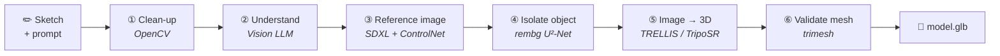

<div align="center">

# ✏️ → 🧊 Sketch2Shape AI

### Turn a single hand-drawn sketch into a textured 3D model (`.glb`)

**Team 3Horcruxes** · TechZephyr 4.0 · IIT Bhubaneswar

`Next.js 16` · `FastAPI` · `SDXL + ControlNet` · `TRELLIS` · `TripoSR` · `100% open-source models`

</div>

---

## 🎯 Objective

Turning a sketch into a 3D model normally takes hours of manual modelling. **Sketch2Shape AI** does it in about
**3 minutes**: draw an object (or upload a photo of a drawing), optionally describe it, and get a **textured 3D
model** you can rotate in the browser and download as a standard `.glb` file.

- 🖊️ **Draw or upload:** a full-screen Excalidraw-style whiteboard, or upload, drag-and-drop or paste a PNG/JPG
- 💬 **Describe (optional):** e.g. *"a red plastic pencil sharpener"*
- 📈 **Live progress:** every step, your GPU queue position and each intermediate image as it appears
- 🧊 **Interactive 3D viewer:** orbit, zoom, auto-rotate, wireframe, then **Download .glb**
- 🆓 **Free and open:** only open-source models and free tiers, no paid APIs
- 🛟 **Robust:** every step is validated, and the online steps have offline fallbacks

---

## 🏗️ Architecture



The **frontend** (Next.js) sends the sketch to `POST /api/generate` and gets a `job_id` back immediately. The
**backend** (FastAPI) runs the six steps as a background job. The page polls `GET /api/status/{job_id}` every
3 seconds and shows the 3D viewer when the job is done.

| Step | What it does | Runs on |
|---|---|---|
| **① Clean-up** | Thresholds the drawing, removes specks, inverts dark backgrounds, centres it on a 1024 px square | Laptop CPU |
| **② Understand** | A vision LLM identifies the object and returns strict JSON (category, materials, colours, image prompt). Rejects non-sketches such as selfies. | Groq (free API) |
| **③ Reference image** | SDXL + ControlNet Scribble turns the sketch into a realistic product photo, keeping the drawn shape | Laptop GPU |
| **④ Isolate object** | Removes the background and cleans the mask (drops stray bits, keeps real holes like a mug handle) | Laptop CPU |
| **⑤ Image → 3D** | **TRELLIS** on a free Hugging Face GPU, with **TripoSR** on the laptop as the automatic fallback | HF ZeroGPU / Laptop |
| **⑥ Validate** | Checks the mesh is not empty, broken or flat, removes bad triangles, centres and scales it, **keeps textures** | Laptop CPU |

> **Why make a 2D image first?** 3D models are trained on real objects, not line drawings. Feeding them a sketch
> gives flat, paper-like results. A clean, realistic image of the object, guided by the sketch, gives a much better
> 3D shape.

---

## 🧠 Model choices

| Step | Model | Why we chose it | Licence |
|---|---|---|---|
| ② | **Qwen** vision model via **Groq** | Reads images, returns strict JSON, ~1 s, free tier. OpenAI also supported (`LLM_PROVIDER=openai`). | Open weights |
| ③ | **SDXL 1.0** + **ControlNet Scribble SDXL** (xinsir) + **SDXL fp16-fix VAE** | Scribble ControlNet is made for rough hand-drawn lines; SDXL gives 1024² photo quality; the fixed VAE avoids black images on Apple GPUs | Open RAIL++-M · Apache-2.0 · MIT |
| ④ | **rembg** with **U²-Net** | Reliable object masks in 1–2 s on CPU | MIT · Apache-2.0 |
| ⑤ | **TRELLIS** (Microsoft) | Best free open image-to-3D model: textured PBR mesh in ~45 s | MIT |
| ⑤ | **TripoSR** (Stability AI + Tripo AI) | Small enough for a laptop and works offline when the free GPU quota runs out | MIT |
| ⑥ | **trimesh** | Standard mesh library that keeps glTF materials intact | MIT |
| Viewer | **three.js** + **React Three Fiber** | Native `.glb` support; studio lighting built in, so no downloads | MIT |

<details>
<summary><b>Changes from the suggested tools, and models we considered</b></summary>

- **Groq + Qwen instead of GPT-4o-mini:** we had no OpenAI credits and wanted everything free and open.
- **SDXL on the laptop instead of a paid image API:** free and private, at the cost of ~2 minutes per image.
- **Free cloud GPU for 3D, with a local fallback:** TRELLIS needs a large NVIDIA GPU, so it runs on Hugging Face's
  free ZeroGPU. TripoSR on the laptop guarantees a result when the daily quota is used up.
- **Hunyuan3D 2.1 (not used):** good geometry, but its licence is not fully open. It needs ~29 GB of NVIDIA VRAM
  and ~3× more GPU time per model, so the free quota would cover far fewer models.

</details>

---

## 💻 Hardware & software

| | What we used |
|---|---|
| **Computer** | Apple Silicon MacBook Pro (arm64), **24 GB+ unified memory**, macOS |
| **Local GPU** | Apple GPU through PyTorch **MPS**, half precision (an NVIDIA GPU with ≥12 GB is used automatically if present) |
| **Remote compute** | Groq free API (step ②) · Hugging Face **ZeroGPU**, a shared NVIDIA GPU on the free tier (step ⑤) |
| **Disk** | ~15 GB for model weights, downloaded once |
| **Software** | Python 3.12 · Node.js 20+ · PyTorch 2.15 · FastAPI · diffusers · transformers · rembg · trimesh · gradio_client · Next.js 16 · React 19 · three.js |

---

## ⚙️ Installation (one time)

You need **Python 3.10–3.12**, **Node.js 20+**, and **git** (the TripoSR setup script uses it to download TripoSR's
code). Unzip the project, then:

**1. Backend**

```bash
cd sketch2shape-ai/backend
python3 -m venv .venv
source .venv/bin/activate          # Windows: .venv\Scripts\activate
pip install -r requirements.txt
cp .env.example .env
python -m scripts.download_models  # downloads ~12 GB of open-source models
python -m scripts.setup_triposr    # sets up the offline 3D fallback (ends with "TripoSR fallback is ready")
```

**2. Add your free keys** in `backend/.env`

| Key | Used for | Get it free at |
|---|---|---|
| `GROQ_API_KEY` | Step ② sketch understanding | [console.groq.com/keys](https://console.groq.com/keys) |
| `HF_TOKEN` | Step ⑤ more free GPU time for TRELLIS (choose a **Read** token) | [huggingface.co/settings/tokens](https://huggingface.co/settings/tokens) |

Both are optional. Without them the app uses a simpler prompt and the offline 3D model.

**3. Frontend**

```bash
cd ../frontend
npm install
cp .env.local.example .env.local   # contains NEXT_PUBLIC_API_URL=http://localhost:8000
```

---

## ▶️ Running

Open **two terminals**:

```bash
# Terminal 1: backend
cd sketch2shape-ai/backend
source .venv/bin/activate
uvicorn app.main:app --port 8000
```

```bash
# Terminal 2: frontend
cd sketch2shape-ai/frontend
npm run dev
```

Open **[http://localhost:3000](http://localhost:3000)**, draw or upload a sketch, and press **Generate 3D Preview**.

> 💡 The image model finishes loading 30–60 s after the backend starts.
> [localhost:8000/api/health](http://localhost:8000/api/health) shows `"status": "ready"` when it is ready.
> Interactive API docs are at [localhost:8000/docs](http://localhost:8000/docs) (see also [`docs/API.md`](docs/API.md)).

---

## 📥 Inputs & 📤 outputs

**Input**

| | |
|---|---|
| **Sketch** | PNG or JPG, up to 10 MB: one object, single view, dark lines on light paper (or light on dark) |
| **Prompt** *(optional)* | Up to 500 characters describing the object, its materials, colours and style |

> ✨ **Best results:** one object drawn at a **three-quarter angle** (showing front, side and top), closed outlines,
> no text. Describe the object (*"a red plastic sharpener"*) rather than giving an instruction (*"make it red"*).

**Output** (saved in `backend/data/jobs/<job_id>/`)

| File | Description |
|---|---|
| 🧊 **`model.glb`** | **The final 3D model.** glTF 2.0 with a PBR material and 1024² texture (TRELLIS) or vertex colours (TripoSR). Centred, resting on the ground, longest side 1 m. Usually 8k–43k triangles, 1.3–2.2 MB. Opens in Blender, Unity, Unreal, three.js and online glTF viewers. |
| `generated.png` · `foreground.png` | AI reference image · isolated object |
| `enrichment.json` | What the vision model understood, and the exact image prompt used |
| `validation.json` | Mesh report: triangles, vertices, size, watertight check, warnings |
| `job.json` | Full record of the job, with the time spent in every step |

---

## ⏱️ Generation time

Measured on the MacBook described above over **12 complete runs** (full log in
[`docs/BENCHMARKS.md`](docs/BENCHMARKS.md)):

| Step | Time |
|---|---|
| ① Clean-up | < 0.1 s |
| ② Understand (Groq) | ~1 s |
| ③ Reference image, 30 steps *(default)* | 116–175 s |
| ③ Reference image, 15 steps *(faster)* | 60–103 s |
| ④ Isolate object | 1–2.5 s |
| ⑤ Image → 3D (TRELLIS, incl. queue) | 38–55 s |
| ⑥ Validate mesh | < 1 s |
| **Total (30 steps)** | **2 min 43 s – 3 min 40 s** · median **~3 min 10 s** |
| **Total (15 steps)** | **1 min 52 s – 2 min 40 s** · median **~2 min 17 s** |

The reference image on the laptop GPU takes **60–80% of the time**. On an NVIDIA RTX 4090-class GPU that step
would typically take ~10 s, bringing the total under ~1.5 minutes.

---

## ⚠️ Limitations

**Issues we hit while generating models**

| Issue | What we did |
|---|---|
| **Free GPU quota on Hugging Face ran out** after bursts of TRELLIS runs (*"exceeded your free ZeroGPU quota… try again in 23:23:09"*), so 3 jobs failed | Automatic fallback to TripoSR on the laptop; the Space is skipped for 30 minutes after a quota error |
| **TripoSR didn't load** with the latest `transformers` library (renamed weight names), so the fallback failed | Fixed: names are converted at load time, and the self-test passes |
| **Groq rate limit** once forced a basic prompt, giving a weaker result | 4 automatic retries; the basic prompt now rewrites instructions into descriptions |
| **"Make it red" coloured the whole scene** (red object on a red background) | Prompts keep colours on the object and force a plain white background |

**Known limitations**

- 🙈 **Hidden sides are guessed:** only one view is drawn, so the back and bottom are invented. Straight-on views
  (e.g. a laptop seen from the front) come out flatter.
- 🎨 **The AI image may reinterpret details:** proportions or small parts can change a little.
- 🕸️ **Thin or see-through parts** (wires, glass, watch hands) may be thickened, merged or missing.
- 🖨️ **Not watertight:** fine for viewing, games and AR, but 3D printing needs a repair step (e.g. in Blender).
- 📏 **Scale is normalised:** the longest side is always 1 m, not the real-world size.
- 🐢 **Speed:** ~2–4 min per model on a laptop. Jobs run one at a time.
- 🌐 **Free services can be busy:** Groq and Hugging Face may rate-limit or queue. Fallbacks keep the app working at
  lower quality (TripoSR gives simpler shapes and blurrier colours).
- 🧪 **Prototype backend:** jobs are kept in memory, so restarting the server forgets them (files stay on disk).
  There are no user accounts. Tested on macOS with Apple Silicon.

**Next steps:** upgrade the main 3D model to **TRELLIS.2** (MIT, better geometry and 4K textures), let the user pick
from several AI images before 3D, store jobs in a database, and add a print-ready (watertight) export.

---

## 🛠️ Troubleshooting

| Problem | Fix |
|---|---|
| `command not found: uvicorn` | Run `source .venv/bin/activate` in `backend/` first |
| *Cannot reach the backend* | Start the backend first, and open the app at `http://localhost:3000` |
| Stuck on "Generating a reference image" | First run downloads models, or the model is still loading (check `/api/health`) |
| `MPS backend out of memory` | Close heavy apps, or set `IMAGE_SIZE=768` in `backend/.env` |
| *Exceeded your free ZeroGPU quota* | Expected after several models; the app switches to TripoSR automatically |
| *TripoSR is not set up* | Run `python -m scripts.setup_triposr` |
| *The 3D model is completely flat* | Redraw the object at a three-quarter angle |
| *This job no longer exists* | The backend was restarted; generate again |

<details>
<summary><b>⚙️ Useful settings (<code>backend/.env</code>)</b></summary>

| Setting | Default | Effect |
|---|---|---|
| `SD_STEPS` | `30` | Image quality vs. speed (15 is ~40% faster) |
| `IMAGE_SIZE` | `1024` | Use `768` if memory is tight |
| `RECON_PROVIDERS` | `trellis,triposr` | 3D model order; `triposr` alone works fully offline |
| `TRELLIS_SS_STEPS` / `TRELLIS_SLAT_STEPS` | `20` / `20` | TRELLIS quality (12 is fastest) |
| `TRELLIS_TIMEOUT_SECONDS` | `300` | Switch to the fallback after this long |
| `REJECT_NON_SKETCHES` | `true` | Reject photos of people or scenes |
| `MESH_NORMALIZE` / `MESH_TARGET_SIZE` | `true` / `1.0` | Centre, ground and scale the final model |

Every setting is explained in `backend/.env.example`.

</details>

<details>
<summary><b>📁 Project structure</b></summary>

```
sketch2shape-ai/
├── README.md
├── docs/
│   ├── API.md                    HTTP API reference
│   └── BENCHMARKS.md             every measured run
├── backend/                      FastAPI + AI pipeline
│   ├── app/
│   │   ├── main.py · routes.py   app setup and API endpoints
│   │   ├── pipeline.py           runs steps ①–⑥ for each job
│   │   ├── jobs.py · schemas.py  job store and data models
│   │   ├── config.py             settings from backend/.env
│   │   └── services/
│   │       ├── image_preprocessing.py      ① clean-up
│   │       ├── semantic_enrichment.py      ② vision LLM + prompts
│   │       ├── image_generation.py         ③ SDXL + ControlNet
│   │       ├── background_removal.py       ④ rembg
│   │       ├── reconstruction*.py          ⑤ TRELLIS + TripoSR fallback
│   │       └── mesh_validation.py          ⑥ trimesh checks
│   ├── scripts/                  model download + TripoSR setup
│   ├── requirements.txt
│   └── .env.example
└── frontend/                     Next.js app
    └── src/
        ├── app/page.tsx          main page
        ├── components/           Whiteboard, ProgressCard, ResultCard, ModelViewer
        ├── hooks/useJobStatus.ts polls job status every 3 s
        └── lib/                  API client and helpers
```

</details>

---

<div align="center">

**Credits:** SDXL (Stability AI) · ControlNet Scribble SDXL (xinsir) · SDXL VAE fp16-fix (madebyollin) ·
rembg / U²-Net · TRELLIS (Microsoft) · TripoSR (Stability AI & Tripo AI) · Qwen (Alibaba) via Groq ·
trimesh · three.js · React Three Fiber · Next.js · FastAPI

Made with ❤️ by **Team 3Horcruxes** for **TechZephyr 4.0**

</div>
